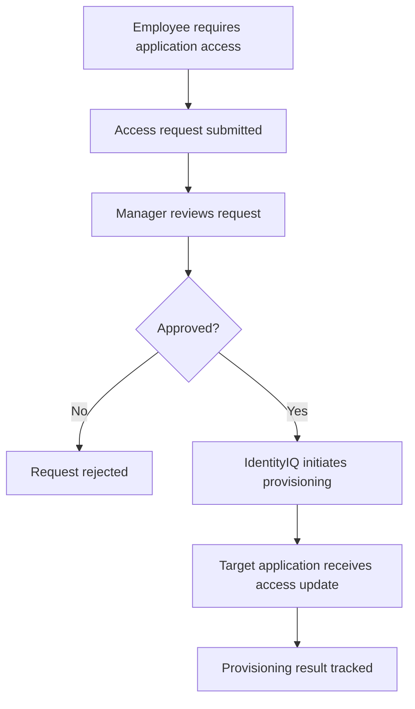
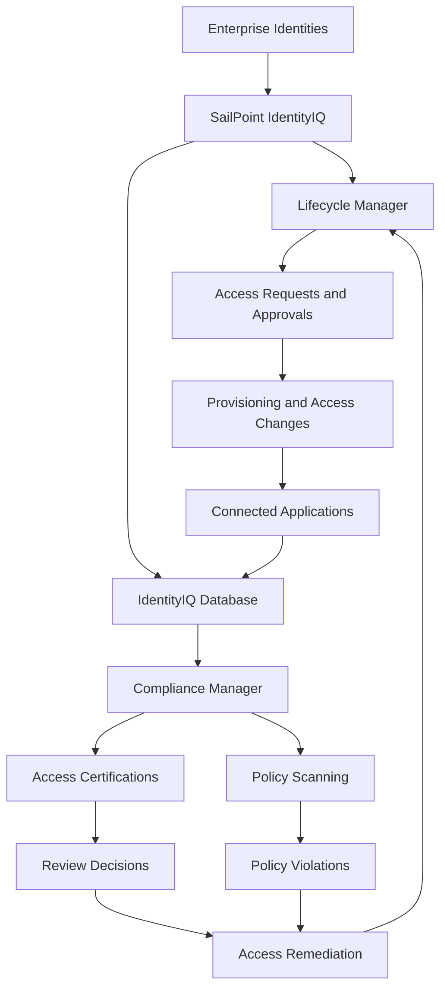

# SailPoint IdentityIQ: Introduction & Fundamentals

> A structured learning resource covering SailPoint IdentityIQ, Identity Governance and Administration (IGA), and enterprise identity security.

## Table of Contents

1. [Introduction to IdentityIQ](#1-introduction-to-identityiq)
2. [Why Organizations Use IdentityIQ](#2-why-organizations-use-identityiq)
3. [Core IdentityIQ Modules](#3-core-identityiq-modules)
   - [Lifecycle Manager](#31-lifecycle-manager-lcm)
   - [Compliance Manager](#32-compliance-manager)
4. [How the Modules Work Together](#4-how-the-modules-work-together)
5. [Other SailPoint Solutions](#5-other-sailpoint-solutions)
6. [IdentityIQ Deployment Models](#6-identityiq-deployment-models)
7. [Important Terminology](#7-important-terminology)
8. [Key Takeaways](#8-key-takeaways)

---

## 1. Introduction to IdentityIQ

**SailPoint IdentityIQ (IIQ)** is an Identity Governance and Administration (IGA) platform that helps organizations manage, monitor, and govern user identities and their access to enterprise resources.

In a typical enterprise, employees use multiple applications, databases, internal systems, and infrastructure platforms. Each employee may have different accounts, roles, permissions, and access privileges across these systems.

Managing all these identities and permissions manually becomes difficult as an organization grows.

IdentityIQ provides centralized visibility and governance over identity and access information.

It helps organizations answer five fundamental questions:

| Question | What it means |
|---|---|
| Who has access? | Which users have accounts across organizational systems? |
| What access do they have? | Which roles, permissions, and entitlements are assigned? |
| Should they have that access? | Does their access match their job responsibilities and organizational policies? |
| What happens when their role changes? | Should their existing access be modified, added, or removed? |
| Can the organization verify access? | Can managers and auditors review and validate access decisions? |

The central objective of IdentityIQ is to ensure that the right people have the right access to the right resources at the right time.

## 2. Why Organizations Use IdentityIQ

IdentityIQ addresses three important organizational requirements.

### 2.1 Security and Risk Reduction

As employees move between departments or change responsibilities, they may retain permissions that are no longer required.

For example:

An employee initially works in the Finance department and has access to financial applications. Later, the employee moves to Human Resources but continues to retain the previous Finance permissions.

This creates unnecessary access and increases the organization's security risk.

IdentityIQ helps organizations:

- Maintain centralized visibility into identities and access.
- Identify inappropriate or excessive permissions.
- Detect policy violations.
- Support access control enforcement.
- Reduce risks associated with unnecessary privileges.

### 2.2 Compliance and Audit Management

Organizations must demonstrate that access to sensitive information is properly controlled.

Regulations such as:

- **HIPAA:** Health Insurance Portability and Accountability Act.
- **GDPR:** General Data Protection Regulation.

require organizations within their respective scopes to meet specific security, privacy, and data protection obligations.

IdentityIQ supports compliance activities through:

- Access certifications.
- Policy scanning and violation detection.
- Reviewable access decisions.
- Repeatable governance processes.
- Audit-supporting records.

**Example:**

A manager periodically reviews the employees who have access to a payroll application and confirms whether each employee still requires that access.

This process is known as an **access certification** or **access review**.

> Important: Using IdentityIQ does not automatically make an organization compliant. It provides capabilities that help organizations implement and demonstrate their access governance controls.

### 2.3 Operational Efficiency

Consider an organization with thousands of employees and hundreds of applications.

Creating accounts, assigning permissions, approving requests, modifying access, and removing access manually would require considerable administrative effort.

IdentityIQ helps automate these processes through:

- Access requests and approval workflows.
- Identity lifecycle management.
- Automated provisioning and deprovisioning.
- Batch access updates.
- Access review processes.

The objective is to make identity and access management more consistent, controlled, and efficient.

---

## 3. Core IdentityIQ Modules

IdentityIQ provides two major functional modules covered in this learning section:

1. Lifecycle Manager (LCM)
2. Compliance Manager

Although they serve different purposes, both work with application access information maintained within the IdentityIQ environment.

### 3.1 Lifecycle Manager (LCM)

Lifecycle Manager focuses on managing access throughout an identity's lifecycle.

It handles access-related activities such as requesting, approving, provisioning, modifying, and removing access.

#### Key Capabilities

| Capability | Description |
|---|---|
| Access Requests | Allows users to request access to applications or permissions. |
| Approval Workflows | Routes access requests to designated managers or approvers. |
| Provisioning | Creates accounts or assigns permissions in connected applications. |
| Deprovisioning | Removes accounts or permissions when access is no longer required. |
| Lifecycle Events | Supports access changes when employees join, move between roles, or leave. |
| Batch Updates | Applies access changes to multiple users in a single operation. |

#### Example: New Employee Joining an Organization

Suppose a new employee joins the Finance department.

The employee requires access to an ERP application.

A simplified access request workflow looks like this:

**Understanding the workflow:**

1. An access request is submitted.
2. The designated manager reviews it.
3. If approved, IdentityIQ initiates the provisioning process.
4. The target application receives the requested account or permission change.
5. IdentityIQ tracks the provisioning result.

The same lifecycle management capabilities can support changes when an employee changes departments or leaves the organization.

#### Batch Updates

Batch updates allow administrators to apply changes to a group of users instead of processing each user individually.

Examples:

- Removing access for multiple users when an application is decommissioned.
- Assigning access to a group of employees following a merger or acquisition.
- Applying organizational access changes to a defined set of users.

### 3.2 Compliance Manager

Compliance Manager focuses on determining whether existing user access is appropriate and consistent with organizational policies.

While Lifecycle Manager helps manage access changes, Compliance Manager helps organizations review and govern the access users already hold.

#### Key Capabilities

**1. Access Certifications**

Access certifications allow designated reviewers, such as managers or application owners, to examine existing user permissions.

They can decide whether access should:

- Remain unchanged.
- Be revoked.
- Be modified, where supported by the organization's review process.

Example:

A Finance manager receives a certification campaign containing employees who have access to the payroll application.

The manager reviews each employee's access and confirms whether it is still required.

**2. Policy Scanning and Violation Detection**

IdentityIQ can evaluate user access against established organizational policies and identify potential violations.

Example:

An employee has permission to create new vendors and approve payments to those vendors.

An organization may define this combination as a Segregation of Duties (SoD) conflict.

IdentityIQ can help identify such conflicts so that the organization can investigate and address them.

#### Lifecycle Manager vs. Compliance Manager

| Area | Lifecycle Manager | Compliance Manager |
|---|---|---|
| Primary purpose | Manage access changes | Govern existing access |
| Main activities | Requests, approvals, provisioning | Certifications, policy monitoring |
| Main question | Who needs access and how should it be assigned? | Is the existing access appropriate? |
| Example | Granting ERP access to a new employee | Reviewing ERP access held by existing employees |

**A useful distinction:** Lifecycle Manager focuses on the access lifecycle, while Compliance Manager focuses on access governance and compliance.

---

## 4. How the Modules Work Together

Lifecycle Manager and Compliance Manager have different responsibilities, but they complement each other.

The course explains that both modules share application access information stored in the IdentityIQ database. They also share the same user interface and implementation processes.

The following diagram illustrates their relationship:

The important idea is that identity and access information can be used by both modules.

- Lifecycle Manager helps initiate and manage access changes.
- Compliance Manager helps evaluate whether existing access remains appropriate.
- Together, they support a continuous access governance process.

---

## 5. Other SailPoint Solutions

The course also introduces two additional SailPoint solutions that can integrate with IdentityIQ.

These should not be confused with the two primary modules discussed above.

### 5.1 File Access Manager (FAM)

File Access Manager focuses on access to files, folders, and other unstructured data.

Traditional identity governance often focuses on accounts and permissions within applications. However, sensitive organizational information may also be stored in shared folders, file servers, and document repositories.

File Access Manager helps organizations:

- Discover access permissions on files and folders.
- Identify who can access sensitive information.
- Locate and secure sensitive data.
- Support data privacy requirements.
- Certify file and folder access for compliance purposes.

**Example:**

An organization stores employee salary information in shared folders.

File Access Manager can help identify which users have access to those folders and support reviews of whether that access is appropriate.

### 5.2 AI-Driven Identity Security

AI-Driven Identity Security uses machine learning and data intelligence to help organizations discover, manage, and control access-related data.

Its purpose is to enhance identity security through intelligent analysis of access information.

**Important architectural distinction:**

According to the course, File Access Manager and AI-Driven Identity Security are separate solutions that can integrate with IdentityIQ.

They have their own:

- Data storage.
- User interfaces.
- Implementation processes.

They are not simply additional modules sharing the same IdentityIQ implementation and database.

---

## 6. IdentityIQ Deployment Models

IdentityIQ can be deployed using different infrastructure and management models.

The course introduces three deployment options.

### 6.1 Data Center / On-Premises Deployment

IdentityIQ is deployed within the organization's own data center.

The organization is responsible for managing:

- Infrastructure.
- IdentityIQ installation.
- Configuration.
- Maintenance.
- Administration.

This model provides the organization with direct control over its environment.

### 6.2 Public Cloud Deployment

IdentityIQ runs on public cloud infrastructure, such as:

- Amazon Web Services (AWS).
- Microsoft Azure.

The infrastructure uses a cloud-based, consumption-oriented model.

However, the organization still manages IdentityIQ itself and requires a team with the appropriate technical expertise.

Moving the infrastructure to the cloud does not automatically mean that the application is managed by the cloud provider.

### 6.3 Cloud Managed Service

In a cloud managed service deployment, a managed service provider takes responsibility for managing the infrastructure and IdentityIQ environment.

This model is useful for organizations that want IdentityIQ capabilities but do not have sufficient in-house resources or expertise to manage the complete environment.

### Deployment Comparison

| Deployment Model | Infrastructure Management | IdentityIQ Management |
|---|---|---|
| On-premises | Organization | Organization |
| Public cloud | Organization, using a cloud provider's infrastructure | Organization |
| Cloud managed service | Managed service provider | Managed service provider |

---

## 7. Important Terminology

The following terms are fundamental to understanding IdentityIQ and will appear throughout the subsequent topics.

| Term | Meaning |
|---|---|
| Identity | A representation of a person or other entity whose access is managed. |
| Account | A user's account within a particular application or system. |
| Entitlement | A specific permission or access right within a system. |
| Provisioning | Creating an account or assigning access. |
| Deprovisioning | Removing an account or access. |
| Access Certification | A formal review of existing access to determine whether it should remain. |
| Policy Violation | A condition in which access conflicts with an established organizational policy. |
| Target Application | An application or system to which IdentityIQ manages or governs access. |
| Segregation of Duties (SoD) | A control principle that prevents conflicting responsibilities from being assigned to the same person. |

These concepts will be explored in greater detail in their respective sections.

---

## 8. Key Takeaways

After studying the introductory concepts, the most important points to understand are:

1. **IdentityIQ is an IGA platform.** It helps organizations manage and govern identities and their access across enterprise systems.
2. **Lifecycle Manager manages access changes.** It supports requests, approvals, provisioning, deprovisioning, and lifecycle-related activities.
3. **Compliance Manager governs existing access.** It supports access certifications, policy scanning, and violation detection.
4. **Both modules share application access information.** They work within the same IdentityIQ environment.
5. **File Access Manager and AI-Driven Identity Security are separate solutions.** They can integrate with IdentityIQ but have separate implementation environments.
6. **IdentityIQ supports different deployment models.** These include on-premises, public cloud, and cloud managed service deployments.

### The One Concept to Remember

IdentityIQ is not simply a tool for creating and deleting user accounts.

It helps organizations understand who has access, determine whether that access is appropriate, manage access changes, and establish evidence that access is being governed properly.

That is the foundation of Identity Governance and Administration.

---

## Learning Reference

These notes were prepared while studying the SailPoint IdentityIQ introductory course.

The material has been reorganized into a conceptual learning guide, with additional explanations and illustrative enterprise scenarios to make the product easier to understand.

**Documentation note:** The diagrams are conceptual illustrations of the capabilities discussed here, not representations of an exact production deployment architecture.

