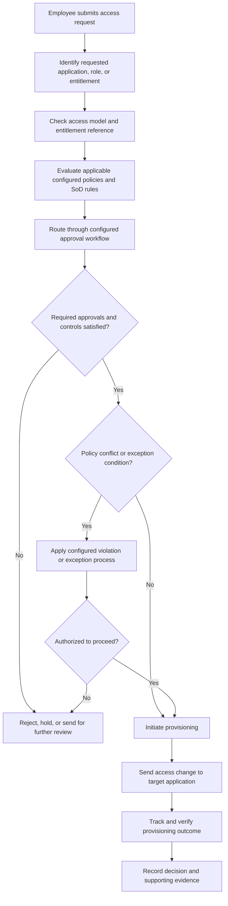
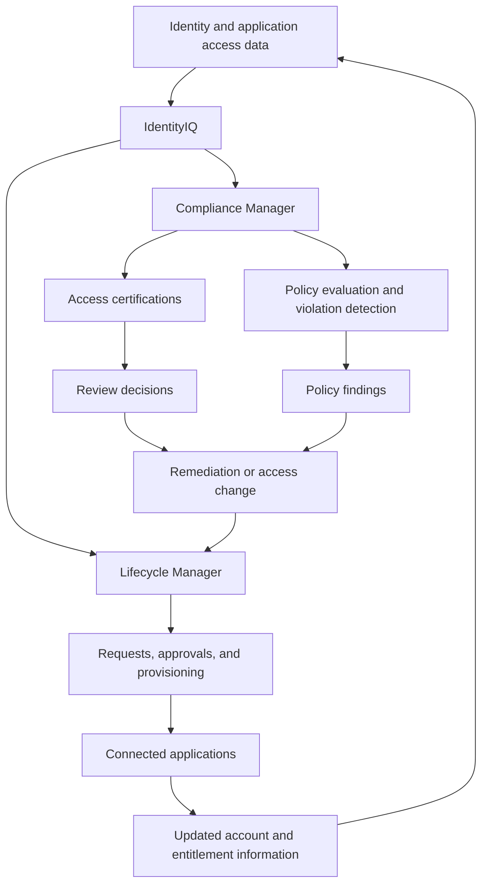

# SailPoint IdentityIQ: Introduction & Enterprise Governance Fundamentals

> A practical learning guide to SailPoint IdentityIQ (IIQ), Identity
> Governance and Administration (IGA), and the organizational controls
> that shape access decisions.

## Table of Contents

1.  [Introduction to IdentityIQ](#1-introduction-to-identityiq)
2.  [Why Organizations Use IdentityIQ](#2-why-organizations-use-identityiq)
3.  [Core IdentityIQ Modules](#3-core-identityiq-modules)
4.  [The Governance Framework Behind Access Decisions](#4-the-governance-framework-behind-access-decisions)
5.  [A Governed Access Request: End-to-End Example](#5-a-governed-access-request-end-to-end-example)
6.  [How Lifecycle Manager and Compliance Manager Work Together](#6-how-lifecycle-manager-and-compliance-manager-work-together)
7.  [Other SailPoint Solutions](#7-other-sailpoint-solutions)
8.  [IdentityIQ Deployment Models](#8-identityiq-deployment-models)
9.  [Important Terminology](#9-important-terminology)
10. [Key Takeaways](#10-key-takeaways)

------------------------------------------------------------------------

## 1. Introduction to IdentityIQ

**SailPoint IdentityIQ (IIQ)** is an Identity Governance and
Administration (IGA) platform that helps organizations manage, monitor,
and govern user identities and their access to enterprise resources.

In a typical enterprise, employees use multiple applications, databases,
internal systems, and infrastructure platforms. Each employee may have
different accounts, roles, permissions, and access privileges across
these systems.

Managing these identities and permissions manually becomes difficult as
an organization grows. IdentityIQ provides centralized visibility and
governance over identity and access information.

It helps organizations answer five fundamental questions:

| Question | What it means |
|---|---|
| Who has access? | Which users have accounts across organizational systems? |
| What access do they have? | Which roles, permissions, and entitlements are assigned? |
| Should they have that access? | Does their access match their job responsibilities and organizational policies? |
| What happens when their role changes? | Should their existing access be modified, added, or removed? |
| Can the organization verify access? | Can managers and auditors review and validate access decisions? |

The central objective of identity governance is to ensure that the right
people have the right access to the right resources at the right time,
supported by appropriate authorization, controls, and evidence.

------------------------------------------------------------------------

## 2. Why Organizations Use IdentityIQ

IdentityIQ addresses three important organizational requirements.

### 2.1 Security and Risk Reduction

As employees move between departments or change responsibilities, they
may retain permissions that are no longer required.

For example, an employee initially works in Finance and has access to
financial applications. Later, the employee moves to Human Resources but
continues to retain the previous Finance permissions.

This creates unnecessary access and increases the organization's
security risk.

IdentityIQ helps organizations:

-   Maintain centralized visibility into identities and access.
-   Identify inappropriate or excessive permissions.
-   Detect configured policy violations.
-   Support access governance and control enforcement.
-   Reduce risks associated with unnecessary privileges.

### 2.2 Compliance and Audit Management

Organizations must demonstrate that access to sensitive information is
properly controlled.

Regulations such as **HIPAA** (Health Insurance Portability and
Accountability Act) and **GDPR** (General Data Protection Regulation)
impose security, privacy, and data-protection obligations on
organizations within their scope.

IdentityIQ supports compliance activities through:

-   Access certifications.
-   Policy scanning and violation detection.
-   Reviewable access decisions.
-   Repeatable governance processes.
-   Audit-supporting records.

**Example:** A manager periodically reviews the employees who have
access to a payroll application and confirms whether each employee still
requires that access. This is an **access certification** or **access
review**.

> Using IdentityIQ does not automatically make an organization
> compliant. The organization must define appropriate controls,
> configure and operate them, and retain evidence that they are working.

### 2.3 Operational Efficiency

Consider an organization with thousands of employees and hundreds of
applications. Creating accounts, assigning permissions, approving
requests, modifying access, and removing access manually would require
considerable administrative effort.

IdentityIQ helps automate or coordinate these activities through:

-   Access requests and approval workflows.
-   Identity lifecycle management.
-   Provisioning and deprovisioning.
-   Batch access updates.
-   Access certification processes.
-   Policy evaluation and violation handling.

The objective is to make identity and access management more consistent,
controlled, and efficient.

------------------------------------------------------------------------

## 3. Core IdentityIQ Modules

The introductory material covers two major IdentityIQ modules:

1.  **Lifecycle Manager (LCM)**
2.  **Compliance Manager**

They have different responsibilities but use identity and application
access information maintained within the IdentityIQ environment.

### 3.1 Lifecycle Manager (LCM)

Lifecycle Manager focuses on managing access throughout an identity's
lifecycle. It supports access requests, approvals, provisioning,
modifications, and removal of access.

| Capability | Description |
|---|---|
| Access requests | Allows users to request access to applications, roles, or permissions. |
| Approval workflows | Routes requests to managers, application owners, or other designated approvers according to the configured workflow. |
| Provisioning | Creates accounts or assigns access in connected applications, where the required integration is configured. |
| Deprovisioning | Removes accounts or access when they are no longer required. |
| Lifecycle events | Supports access changes when employees join, move between roles, or leave. |
| Batch updates | Applies access changes to multiple users. |

#### Example: A new employee requests ERP access

A new Finance employee needs access to an ERP application. The request
is submitted through the configured access request process. IdentityIQ
can evaluate the requested access, route approvals, and initiate
provisioning when the configured workflow's requirements are satisfied.

The important point is that **LCM is not just an account-creation
mechanism**. It can coordinate the request, approval, and provisioning
stages.

### 3.2 Compliance Manager

Compliance Manager focuses on determining whether existing user access
is appropriate and consistent with organizational policies.

Its key capabilities include:

**Access certifications**

Designated reviewers, such as managers or application owners, examine
existing user access and decide whether it should remain or be revoked.

Example: A Finance manager reviews employees who have access to a
payroll application and confirms whether each employee still needs that
access.

**Policy scanning and violation detection**

IdentityIQ can evaluate user access against configured organizational
policies and identify potential violations.

Example: An employee has permission to create new vendors and approve
payments to those vendors. The organization may define this combination
as a Segregation of Duties (SoD) conflict. IdentityIQ can identify the
conflict for investigation and remediation when the relevant policy is
configured.

### 3.3 Lifecycle Manager vs. Compliance Manager

| Area | Lifecycle Manager (LCM) | Compliance Manager | How they complement each other |
|---|---|---|---|
| Primary purpose | Manage access changes | Govern and review access | LCM executes access changes; Compliance Manager reviews whether those changes remain appropriate |
| Key capabilities | Access requests, approvals, provisioning, deprovisioning, lifecycle events, batch updates | Access certifications, policy scanning and violation detection | Compliance Manager findings can trigger LCM-driven access changes such as revocation or remediation |
| Main question | How should access be requested and assigned? | Is the access held by the user appropriate? | Together they cover both the granting and the ongoing review of access |
| Example | Granting ERP access to a new employee | Reviewing ERP access held by existing employees | LCM handles onboarding access; Compliance Manager periodically confirms that access is still needed |

A useful distinction: **Lifecycle Manager helps manage access changes;
Compliance Manager helps assess and govern access.** Their capabilities
complement one another.

------------------------------------------------------------------------

## 4. The Governance Framework Behind Access Decisions

Understanding the IdentityIQ modules is only part of understanding
enterprise access management. Before an organization can automate access
decisions, it needs to define what appropriate access means.

A manager's approval can confirm that an employee has a business need
for access. However, business need is not the only consideration. The
requested access may also need to comply with the organization's access
model, entitlement definitions, segregation-of-duties requirements,
approval authority, and operational procedures.

These requirements are usually documented and maintained by the
organization. IdentityIQ can be configured to implement selected
requirements through its identity model, application data, roles,
policies, workflows, rules, and integrations.

**The distinction to remember: the governance documents define the
organization's requirements; IdentityIQ is the platform that can
operationalize configured parts of those requirements.**

### 4.1 The governance references an organization may maintain

The following documents form a practical example of an IAM governance
framework. They are useful reference artifacts for understanding the
information and decisions that may sit behind an enterprise access
request.

| Governance reference | What it defines | Why it matters | How it may inform IdentityIQ |
|---|---|---|---|
| Access Control Policy | Organization-wide principles and requirements for granting, reviewing, changing, and removing access. | Sets the governing rules that all access decisions should follow. | Provides the governing requirements that can be translated into IdentityIQ roles, policies, workflows, and operational controls. |
| RBAC Matrix | Which business or technical roles should receive which access. | Maps roles to access so assignments are consistent and auditable. | Can inform IdentityIQ role design, role assignments, and role-based access provisioning. |
| Entitlement Catalogue | Available application permissions, their meaning, ownership, and risk or sensitivity. | Makes individual entitlements visible and understandable to reviewers and approvers. | Helps organize and interpret application entitlements aggregated or managed in IdentityIQ. |
| Approval Matrix | Who is authorized to approve different categories of access. | Ensures access requests go to the right decision-makers. | Informs approval routing and workflow configuration. |
| SoD Policy and Rules Register | Which combinations of access or responsibilities create conflicts, and how conflicts should be handled. | Prevents or detects incompatible access combinations held by one person. | Informs policy definitions, SoD rules, violation evaluation, and remediation processes. |
| Provisioning and Deprovisioning SOP | Operational steps, checks, evidence, and closure requirements for access changes. | Standardises how access is fulfilled, verified, and closed. | LCM workflows and target application integrations can automate or support relevant process steps. |
| Exception Management SOP | How policy conflicts, failed requests, urgent access, and exceptions are assessed, approved, tracked, and closed. | Ensures deviations from policy are controlled, not informal bypasses. | Informs configured violation handling, remediation, and escalation processes. |

**What about ABAC?**

Attribute-Based Access Control (ABAC) uses attributes such as
department, location, employment type, or other defined characteristics
when making access decisions. Attribute-based conditions may be
implemented through supported IdentityIQ configuration and rules,
depending on the design and version. Do not assume that a separate ABAC
spreadsheet is automatically imported or that every ABAC model is
available out of the box.

**Important:** The linked IdentityGuard documentation pack described in
the Practical Governance References section includes an RBAC Matrix but
does **not** include a separate ABAC matrix. ABAC is discussed here as
a related access-control model, not as a document in the linked pack.

### 4.2 These documents are not the same thing

It is useful to separate four layers:

| Layer | Purpose | Example |
|---|---|---|
| Policy | Defines what must or must not happen. | Users must not hold conflicting Finance entitlements. |
| Reference data | Defines the roles, permissions, owners, and approval relationships used to make decisions. | RBAC matrix, entitlement catalogue, approval matrix. |
| Platform configuration | Implements selected requirements in a system. | IdentityIQ roles, policy rules, approval workflows, application integrations. |
| Operating procedure | Explains how people perform and evidence the process. | Provisioning SOP, exception management SOP. |

A policy document or spreadsheet does not become an IdentityIQ control
merely because it exists. The relevant requirements must be assessed,
translated into suitable configuration, tested, and maintained.

IdentityIQ does not automatically ingest every organizational policy,
spreadsheet, matrix, SOP, or approval document and convert it into
enforceable controls. These requirements need to be translated into an
appropriate implementation and configuration.

### 4.3 Does manager approval alone authorize provisioning?

**Not necessarily.** Manager approval is one input to an authorization
process, not universal proof that a request is permissible.

Access decisions may depend on:

-   The organization's access control policy.
-   Role and entitlement definitions.
-   Approval requirements.
-   Segregation of Duties rules.
-   Other configured policies and controls.
-   Exception handling requirements.

Consider a request for a financial application entitlement:

1.  The employee requests a specific application role or entitlement.
2.  The request is checked against the organization's access model and
    available entitlement information.
3.  Applicable SoD and other configured policy rules are evaluated.
4.  The request is routed to the approvers required by the configured
    approval process.
5.  Policy violations, missing approvals, or exceptions are handled
    according to the organization's control design.
6.  Provisioning proceeds only when the workflow's required conditions
    are satisfied.

The exact order of approvals and policy checks depends on the IdentityIQ
implementation. Some checks may occur before approval, during workflow
execution, or as part of subsequent governance monitoring.

**IdentityIQ does not automatically know the contents of every
organization's approval matrix or SOP.** Those requirements must be
represented in the relevant platform configuration and operating
process.

### 4.4 How SoD controls fit into IdentityIQ

Suppose an organization defines the following conflicting
responsibilities:

-   Vendor Creation
-   Payment Approval

A user who holds both entitlements may be able to create a vendor and
approve payments to that vendor. The organization may therefore prohibit
the combination.

IdentityIQ provides policy-management capabilities that can be
configured to identify access-policy violations. The organization's SoD
rules can inform those policy definitions.

Two useful control categories are:

| Control type | Purpose | Example |
|---|---|---|
| Preventive | Identify or stop problematic access before it is provisioned. | Evaluate a requested entitlement for an SoD conflict during an access request workflow. |
| Detective | Identify a conflict in access that a user already holds. | Evaluate existing identities and entitlements to find an SoD violation. |

A detected violation does not necessarily mean that every IdentityIQ
deployment will automatically reject the request. The configured policy
and workflow determine the response. Depending on the design, the
request may be blocked, held for review, routed for remediation, or
considered through an authorized exception process.

A detected violation may require investigation, remediation, or an
approved exception, depending on organizational policy.

### 4.5 What happens when a policy exception is needed?

Sometimes a business requirement cannot be met using the standard access
model. An organization may permit an exception, but it should be
controlled rather than treated as an informal bypass.

An exception process may require:

-   A documented business justification.
-   Approval from the designated authority.
-   Identification of the policy or control being excepted.
-   Defined scope and duration, where applicable.
-   Compensating controls to reduce the risk.
-   An owner and review date.
-   Evidence of the decision and eventual closure.

IdentityIQ can support parts of policy-violation handling and configured
workflows. The full exception-management procedure, including
responsibilities and evidence requirements, remains an organizational
governance process. Requirements vary by organization; not every
organization uses identical exception requirements.

### 4.6 What IdentityIQ does not do automatically

IdentityIQ is a platform, not a substitute for the organization's
governance framework.

It does not automatically:

-   Read every policy, SOP, spreadsheet, or approval matrix and convert
    it into enforceable system rules.
-   Know who should approve every request without the relevant identity
    data and workflow configuration.
-   Guarantee that a policy is correctly designed or reflects the
    organization's actual risk.
-   Automatically reject every policy violation in every implementation.
-   Replace operational procedures, control ownership, evidence
    requirements, or human accountability.

The organization defines the governance requirements. IdentityIQ
provides capabilities to implement, automate, monitor, and evidence
selected parts of that framework.

------------------------------------------------------------------------

## 5. A Governed Access Request: End-to-End Example

**Scenario:** A Finance employee requests an entitlement in an ERP
application.

The diagram below illustrates a logical governance process. It is a
conceptual example and is not a universal, fixed IdentityIQ workflow.
Actual policy-check placement, approval routing, exception handling, and
provisioning integrations depend on the organization's configuration.

### Understanding the stages

1.  **Request:** The employee requests a specific application, role, or
    entitlement.
2.  **Access validation:** The requested access is checked against the
    organization's access model and available application and
    entitlement information.
3.  **Policy evaluation:** Applicable SoD and other configured policy
    rules are evaluated.
4.  **Approval routing:** IdentityIQ routes the request according to the
    configured workflow. The manager may be one of several required
    approvers.
5.  **Decision:** The workflow determines whether the required approvals
    and controls have been satisfied. A policy violation may require
    rejection, further review, mitigation, or an authorized exception.
6.  **Provisioning:** IdentityIQ initiates the access change through the
    configured provisioning integration or process.
7.  **Verification and evidence:** The provisioning result is tracked,
    and the organization retains appropriate records of the request,
    approvals, policy outcomes, and fulfilment.

### 5.1 Example: A request creates an SoD conflict

Suppose the employee already has the Vendor Creation entitlement and
requests Payment Approval. The organization's SoD rules prohibit the
combination.

The manager may approve the business need, but that approval does not
remove the conflict.

IdentityIQ can identify the configured policy violation. The workflow
must then follow the organization's configured response. Depending on
the control design, the request may be stopped, sent for additional
review, or considered under a formally authorized exception and
mitigation process.

### 5.2 Governance approval vs. provisioning procedure

These are related but different stages:

-   **Approval and policy evaluation** determine whether the access
    request is authorized under the configured governance controls.
-   **Provisioning** carries out the approved access change in the
    target application.
-   **Verification and closure** confirm the outcome and record
    evidence.

The Provisioning and Deprovisioning SOP defines the operational
expectations around fulfilment, verification, evidence, and closure.
IdentityIQ can automate or support parts of that procedure, but the SOP
itself remains an organizational operating document.

------------------------------------------------------------------------

## 6. How Lifecycle Manager and Compliance Manager Work Together

Lifecycle Manager and Compliance Manager use identity and access
information for complementary purposes.

-   Lifecycle Manager helps initiate and manage access changes.
-   Compliance Manager helps review existing access and identify policy
    violations.
-   Certification and policy findings can lead to remediation, which may
    involve access removal or another controlled change through the
    appropriate process.

LCM supports access requests, approvals, provisioning, and lifecycle
changes. Compliance Manager supports certifications, policy scanning,
and violation detection. Governance findings may lead to remediation or
access changes. The diagram illustrates how the two modules complement
one another; it does not imply that one module automatically performs
every task of the other.

The introductory course describes Lifecycle Manager and Compliance
Manager as sharing application access data in the IdentityIQ database,
as well as the same user interface and implementation processes.

------------------------------------------------------------------------

## 7. Other SailPoint Solutions

The introductory material also introduces two additional SailPoint
solutions that can integrate with IdentityIQ. They should not be
confused with the two primary modules discussed above.

### 7.1 File Access Manager (FAM)

File Access Manager focuses on access to files, folders, and other
unstructured data.

Sensitive organizational information may be stored in shared folders,
file servers, and document repositories, not only in business
applications.

File Access Manager helps organizations:

-   Discover access permissions on files and folders.
-   Identify who can access sensitive information.
-   Locate and secure sensitive data.
-   Support data privacy requirements.
-   Certify file and folder access for compliance purposes.

**Example:** An organization stores employee salary information in
shared folders. File Access Manager can help identify which users have
access to those folders and support reviews of whether that access is
appropriate.

### 7.2 AI-Driven Identity Security

AI-Driven Identity Security uses machine learning and data intelligence
to help organizations discover, manage, and control access-related data.

File Access Manager and AI-Driven Identity Security are separate SailPoint
solutions that can integrate with IdentityIQ. They are not IdentityIQ
modules. They have their own data storage, user interfaces, and
implementation processes.

They are not simply additional modules sharing the same IdentityIQ
implementation and database.

------------------------------------------------------------------------

## 8. IdentityIQ Deployment Models

The introductory material describes three deployment options.

### 8.1 Data Center / On-Premises Deployment

IdentityIQ is deployed within the organization's own data center. The
organization manages the infrastructure, installation, configuration,
maintenance, and administration.

### 8.2 Public Cloud Deployment

IdentityIQ runs on public cloud infrastructure, such as Amazon Web
Services (AWS) or Microsoft Azure.

In the deployment model described in the course, the organization still
manages IdentityIQ, while the infrastructure shifts to a cloud-based,
consumption-oriented model.

Moving infrastructure to the cloud does not automatically mean the cloud
provider manages the IdentityIQ application.

### 8.3 Cloud Managed Service

A managed service provider manages the infrastructure and IdentityIQ
environment. This model can suit organizations that want IdentityIQ
capabilities but do not have sufficient in-house resources to operate
the environment.

| Deployment model | Infrastructure management | IdentityIQ management |
|---|---|---|
| On-premises | Organization | Organization |
| Public cloud | Organization, using a cloud provider's infrastructure | Organization |
| Cloud managed service | Managed service provider | Managed service provider |

Availability of specific deployment options may depend on the IdentityIQ
version and offering. Where product terminology or availability is
version-dependent, consult the documentation for your IdentityIQ
version.

------------------------------------------------------------------------

## 9. Important Terminology

| Term | Meaning |
|---|---|
| Identity | A representation of a person or other entity whose access is managed. |
| Account | A user's account within a particular application or system. |
| Entitlement | A specific permission or access right within a system. |
| Provisioning | Creating an account or assigning access. |
| Deprovisioning | Removing an account or access. |
| Access certification | A formal review of existing access to determine whether it should remain. |
| Policy violation | A condition in which access conflicts with an established organizational policy. |
| Target application | An application or system to which IdentityIQ manages or governs access. |
| RBAC | Role-Based Access Control: access is assigned through defined roles. |
| ABAC | Attribute-Based Access Control: access decisions use defined attributes and conditions. |
| SoD | Segregation of Duties: a control principle that prevents conflicting responsibilities from being assigned to the same person. |
| Exception | A formally reviewed and authorized deviation from a defined policy or control requirement. |
| Compensating control | An alternative control used to reduce risk when the standard control cannot be followed. |
| SOP | Standard Operating Procedure: documented steps for carrying out an operational process consistently. |

------------------------------------------------------------------------

## 10. Key Takeaways

1.  **IdentityIQ is an IGA platform.** It helps organizations manage and
    govern identities and their access across enterprise systems.
2.  **Lifecycle Manager manages access changes.** It supports requests,
    approvals, provisioning, deprovisioning, and lifecycle-related
    activities.
3.  **Compliance Manager governs existing access.** It supports access
    certifications, policy evaluation, and violation detection.
4.  **Manager approval alone is not universally sufficient.** Requests
    may also need to satisfy role, entitlement, SoD, policy, and
    approval requirements.
5.  **Governance requirements come from the organization.** Policies,
    matrices, catalogues, and SOPs define the expected controls and
    operating process.
6.  **IdentityIQ can operationalize selected governance requirements.**
    Roles, policies, workflows, rules, and integrations must be
    configured to reflect them.
7.  **Policy violations need a defined response.** Depending on
    configuration, they may be blocked, reviewed, or handled through an
    authorized exception process.
8.  **SOPs remain organizational procedures.** IdentityIQ can automate
    or support their steps, but it does not replace the procedures or
    the people responsible for them.
9.  **File Access Manager and AI-Driven Identity Security are separate
    solutions.** They can integrate with IdentityIQ but have separate
    implementation environments.
10. **IdentityIQ supports different deployment models.** These include
    on-premises, public cloud, and cloud managed service.

### The Main Idea

IdentityIQ is not simply a tool for creating and deleting user accounts.

It helps organizations understand who has access, evaluate whether that
access is appropriate, manage access changes, and maintain evidence that
access is being governed.

**The organization defines the governance requirements. IdentityIQ
provides the platform capabilities to implement and operate selected
parts of that governance framework.**

------------------------------------------------------------------------

## Practical Governance References

To make the governance concepts in this chapter easier to understand,
the following practical IAM documentation set provides examples of the
kinds of reference artifacts an organization may maintain.

**IAM Governance and Operations documentation pack**\
[Open the documentation pack in the IdentityGuard
repository](https://github.com/Alisha-chaudhary/IdentityGuard/tree/main/IAM-Governance-and-Operations)

The pack contains the following training-reference documents:

| Reference document | What readers can learn from it |
|---|---|
| [Access Control Policy](https://github.com/Alisha-chaudhary/IdentityGuard/blob/main/IAM-Governance-and-Operations/01-Governance-Framework/01-Access-Control-Policy.docx) | How an organization defines access-control principles, responsibilities, and requirements. |
| [RBAC Matrix](https://github.com/Alisha-chaudhary/IdentityGuard/blob/main/IAM-Governance-and-Operations/01-Governance-Framework/02-RBAC-Matrix.xlsx) | How business roles are mapped to application access. |
| [Entitlement Catalogue](https://github.com/Alisha-chaudhary/IdentityGuard/blob/main/IAM-Governance-and-Operations/01-Governance-Framework/03-Entitlement-Catalogue.xlsx) | How application permissions are inventoried and described. |
| [Approval Matrix](https://github.com/Alisha-chaudhary/IdentityGuard/blob/main/IAM-Governance-and-Operations/01-Governance-Framework/04-Approval-Matrix.xlsx) | How approval responsibilities can be assigned to different access requests. |
| [SoD Policy and Rules Register](https://github.com/Alisha-chaudhary/IdentityGuard/blob/main/IAM-Governance-and-Operations/01-Governance-Framework/05-SoD-Policy-and-Rules-Register.docx) | How conflicting responsibilities and access combinations can be documented. |
| [Provisioning and Deprovisioning SOP](https://github.com/Alisha-chaudhary/IdentityGuard/blob/main/IAM-Governance-and-Operations/02-Operational-Procedures/06-Provisioning-and-Deprovisioning-SOP.docx) | How access fulfilment, verification, evidence, and closure can be handled consistently. |
| [Exception Management SOP](https://github.com/Alisha-chaudhary/IdentityGuard/blob/main/IAM-Governance-and-Operations/02-Operational-Procedures/07-Exception-Management-SOP.docx) | How failed requests, policy exceptions, escalation, and remediation can be managed. |

### Understanding the training examples

These documents are part of a practical IAM governance and operations
learning exercise associated with the IdentityGuard project. They are
provided as **illustrative training references**, not as SailPoint
documentation, official IdentityIQ templates, or real corporate
policies.

The sample organization, **Asteron Financial Services**, is fictional.
Its applications, roles, entitlements, approval structures, and employee
scenarios are proposed training data. They are intended to help readers
understand how governance requirements can be documented and then mapped
to identity-management processes.

The documents do not represent an automatic IdentityIQ integration. They
illustrate the organizational inputs that an IAM team would need to
assess before configuring a platform such as IdentityIQ.

IdentityGuard is a self-created learning project, not a commercial IAM
product. The linked documents are not official IdentityIQ implementation
requirements.

**Scope note:** The listed document set includes an RBAC Matrix but does
not include a separate ABAC matrix. ABAC is discussed in this chapter as
a related access-control model, not as a document in the linked pack.

**Diagram note:** The diagrams in this chapter are conceptual learning
illustrations. They are not screenshots, product architecture diagrams,
or claims about a universal production workflow.
