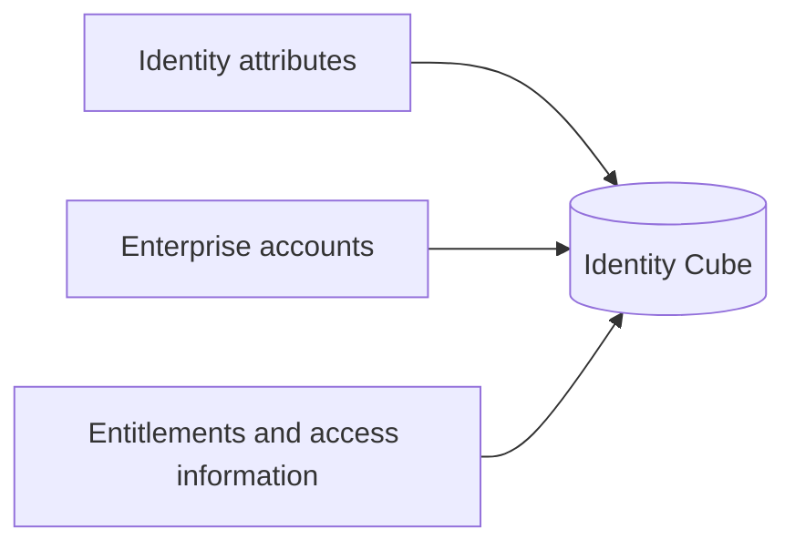
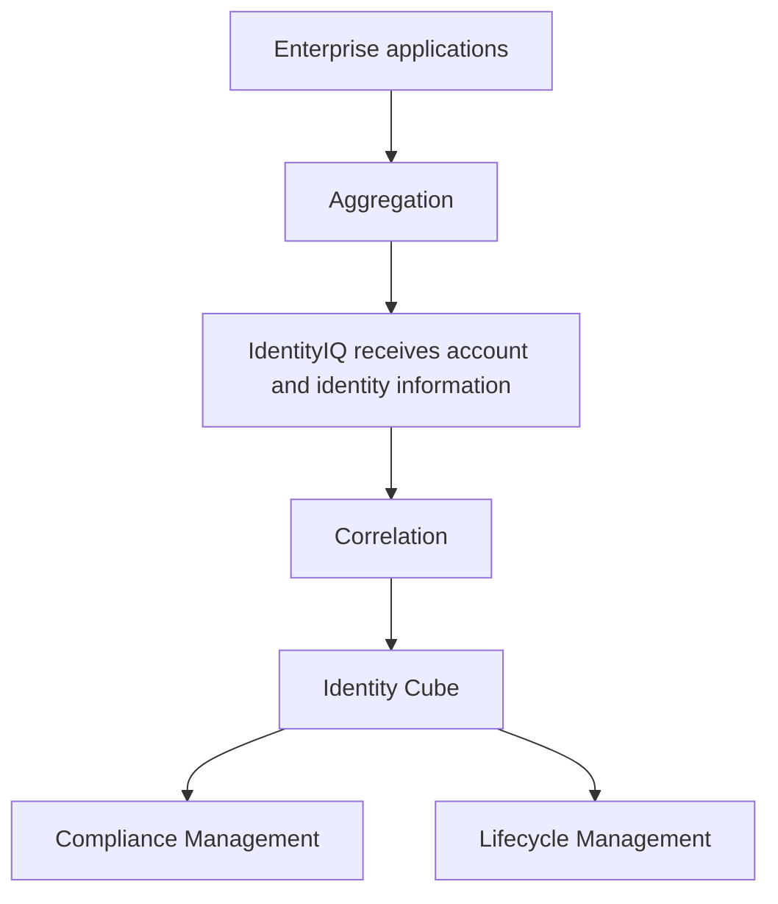

# SailPoint IdentityIQ: Chapter 2, Topic 4 — Identities

> A practical learning guide to SailPoint IdentityIQ (IIQ), Identity
> Governance and Administration (IGA), and the identity concepts that
> support access governance.

## Table of Contents

1.  [What Is an Identity?](#1-what-is-an-identity)
2.  [Identity Cube](#2-identity-cube)
3.  [Important Terminology](#3-important-terminology)
4.  [How IdentityIQ Builds an Identity View](#4-how-identityiq-builds-an-identity-view)
    *   [4.1 Aggregation](#41-aggregation)
    *   [4.2 Correlation](#42-correlation)
5.  [Aggregation and Correlation Workflow](#5-aggregation-and-correlation-workflow)
6.  [What Happens After Identity Data Is Collected?](#6-what-happens-after-identity-data-is-collected)
    *   [6.1 Compliance Management](#61-compliance-management)
    *   [6.2 Lifecycle Management](#62-lifecycle-management)
7.  [Key Takeaways](#7-key-takeaways)
8.  [Knowledge Check](#8-knowledge-check)

------------------------------------------------------------------------

## 1. What Is an Identity?

An **identity** represents a person or non-human entity that needs access to
an organization's systems and data. In identity and access management (IAM),
an identity is the answer to the question "who needs access?"

Identities are not limited to human users. Examples include:

-   **Employees** — people on the organization's payroll.
-   **Contractors** — people working for the organization on a temporary
    or third-party basis.
-   **Business partners** — people from partner organizations who need
    limited access to the organization's systems.
-   **Service accounts** — accounts used by applications or automated
    processes to communicate with other systems.
-   **Robotic or automated users** — identities used by scripts, bots, or
    robotic process automation (RPA) tools.

### Identity versus account

These two terms are related but different:

-   **Identity** — who the person or entity is.
-   **Account** — the representation of that identity within a particular
    application or system.

One identity can have multiple application accounts. For example, the same
employee might have an email account, an HR system account, an ERP account,
and an Active Directory account. IdentityIQ governs the identity, while each
application governs its own account for that identity.

------------------------------------------------------------------------

## 2. Identity Cube

IdentityIQ represents each identity through an **Identity Cube** — a
consolidated view of everything IdentityIQ knows about that identity.

An Identity Cube can contain:

-   **Identity attributes** — information such as name, email address,
    department, employee ID, manager, and employment status.
-   **Enterprise accounts** — the identity's accounts in connected
    applications, such as Active Directory, an ERP system, or a database.
-   **Entitlements and access information** — roles, groups, permissions,
    and other access rights assigned to the identity within those
    applications.

### What an Identity Cube is not

An Identity Cube is:

-   not a separate user account,
-   not a physical object, and
-   not the application account itself.

It is IdentityIQ's internal, consolidated representation of an identity. It
gathers identity information from multiple connected sources so that access
decisions can be made in one place, based on a complete picture.

### Identity Cube contents (learning illustration)

This diagram is a conceptual learning illustration of what can sit inside
an Identity Cube. It is not a product architecture diagram.

------------------------------------------------------------------------

## 3. Important Terminology

The table below defines the core terms used in this chapter.

| Term | Meaning | Example |
|---|---|---|
| Identity | A person or non-human entity whose access is managed by the organization. | An employee named Alisha Chaudhary. |
| Identity Cube | IdentityIQ's consolidated representation of an identity, including its attributes, accounts, and access information. | All of Alisha's attributes, application accounts, and entitlements viewed together in IdentityIQ. |
| Attribute | A property or piece of information describing an identity, account, application, or entitlement. | Email address, department, employee ID, or account status. |
| Application | A managed resource where access is held, such as a directory, database, or business application. | Active Directory, an ERP system, or a payroll database. |
| Entitlement | A permission or access right within an application; also called access or a permission. | Membership in an Active Directory group, or the ability to approve invoices in an ERP system. |
| Aggregation | The process of collecting or reading identity-related data from connected enterprise applications into IdentityIQ. | Reading user accounts and group memberships from Active Directory on a scheduled basis. |
| Correlation | The process of matching collected application accounts to the correct identity so that accounts are associated with their actual owners. | Matching the Active Directory account `achaudhary` to the HR identity `alisha.chaudhary`. |

### How the terms relate

To keep these terms straight, remember:

-   **Identity = who** needs access.
-   **Application = where** access is held.
-   **Entitlement = what** access is granted.
-   **Attribute = information** describing an identity, account, application, or entitlement.

**Attribute versus entitlement:** an attribute is a property or piece of
information (for example, department). An entitlement is a permission or
access right (for example, membership in a group that allows invoice
approval). They are not interchangeable.

**Application versus entitlement:** an application is the managed resource;
an entitlement describes access within that resource.

------------------------------------------------------------------------

## 4. How IdentityIQ Builds an Identity View

Accurate and standardized identity data is important. Aggregation,
correlation, and every governance decision that follows depend on it. If
source data is inconsistent, incomplete, or duplicated, IdentityIQ may
create multiple views of the same person or associate accounts with the
wrong identity.

### 4.1 Aggregation

**Aggregation** collects or reads identity-related data from connected
enterprise applications into IdentityIQ.

Data may come from:

-   HR systems (employee records, department, manager, hire date).
-   Directories such as Active Directory (accounts, groups, memberships).
-   Databases (application user tables and permissions).
-   Business applications (ERP, CRM, payroll, and other systems).

Aggregation runs periodically, on a configured schedule, to keep
IdentityIQ information up to date as people join, move, or leave the
organization.

**Practical example:** An organization's HR system is the authoritative
source for employee details. Each night, IdentityIQ aggregates employee
records from the HR system, capturing names, departments, managers, and
employment status. Separately, it aggregates account and group membership
data from Active Directory.

### 4.2 Correlation

**Correlation** matches collected application accounts to the correct
identity. IdentityIQ can use configured correlation rules and identity
information to perform this matching. The purpose is to associate accounts
with their actual owners, so that all of one person's accounts belong to
one Identity Cube.

**Worked example:**

1.  The HR system identifies an employee as `alisha.chaudhary`.
2.  Active Directory contains the account `achaudhary`.
3.  IdentityIQ uses configured correlation rules and identity information to
    associate the Active Directory account with the correct identity.

### Aggregation versus correlation

These steps are related but different:

-   **Aggregation** collects the data from applications.
-   **Correlation** decides which identity that data belongs to.

Aggregation without correlation would leave IdentityIQ with accounts but no
clear owner. Correlation without aggregation would have nothing to match.

------------------------------------------------------------------------

## 5. Aggregation and Correlation Workflow

The flowchart below shows how IdentityIQ builds a consolidated identity
view from enterprise applications and how that view feeds governance.

**How to read the diagram:**

1.  **Enterprise applications** — the source systems where identities have
    accounts and access (for example, HR systems and Active Directory).
2.  **Aggregation** — IdentityIQ collects account and identity data from
    those applications.
3.  **IdentityIQ receives account and identity information** — the collected
    data lands in IdentityIQ for processing.
4.  **Correlation** — IdentityIQ matches collected accounts to the correct
    identities using configured correlation rules.
5.  **Identity Cube** — correlated information is stored as a consolidated
    representation of each identity.
6.  **Compliance Management** — uses the identity view to review and govern
    existing access.
7.  **Lifecycle Management** — uses the identity view to manage access
    changes over time.

> **Diagram note:** This is a conceptual learning diagram based on the
> course explanation, not a complete product architecture. Actual
> integration points, data flow, and processing order depend on the
> organization's IdentityIQ configuration.

------------------------------------------------------------------------

## 6. What Happens After Identity Data Is Collected?

Once identity data is aggregated, correlated, and normalized, IdentityIQ
can use it to support compliance management and lifecycle management.
"Normalized" means the data has been brought into a consistent format so
that it can be compared, evaluated, and acted on reliably.

Identity data and the organization's access model provide the context for
governance decisions. For example, an employee's department can determine
which access is appropriate and what should happen when the employee moves
to another department.

| Area | Compliance Management | Lifecycle Management |
|---|---|---|
| Primary purpose | Govern and review existing access. | Manage identity and access changes over time. |
| Focus | Whether users have appropriate access. | How users receive, change, or lose access. |
| Examples | Access certifications, policy scanning, violation detection. | Access requests, approvals, provisioning, deprovisioning. |
| Main question | Is existing access appropriate? | How should access change? |

### 6.1 Compliance Management

Compliance Management helps organizations evaluate whether users have
appropriate access according to governance requirements.

Examples:

-   Reviewing access that employees no longer need after a role change.
-   Identifying conflicting permissions, such as a user who can both
    create vendors and approve payments to them.
-   Reviewing existing access against organizational policies and
    regulatory requirements.

Typical activities include access certifications, where managers or
application owners confirm whether each user's access should remain or be
revoked, and policy scanning to detect violations.

### 6.2 Lifecycle Management

Lifecycle Management manages identity and access changes throughout an
identity's lifecycle, from joining the organization to leaving it.

Examples:

-   A new employee joins and requires access to the applications needed
    for the job.
-   An employee changes departments and requires different permissions.
-   An employee leaves the organization and their access must be removed.

Identity data and the organization's access model provide context for
these changes. For instance, when an employee moves departments, the
access model helps determine which access should be removed and which new
access should be granted.

Compliance Management and Lifecycle Management complement each other:
certification findings from Compliance Management can trigger access
changes through Lifecycle Management.

------------------------------------------------------------------------

## 7. Key Takeaways

1.  **An identity can represent a human or non-human entity.**
2.  **IdentityIQ uses an Identity Cube to maintain a consolidated
    representation of an identity.**
3.  **Attributes describe identities, accounts, applications, and
    entitlements.**
4.  **Aggregation collects information from connected enterprise
    applications.**
5.  **Correlation associates collected accounts with the correct
    identities.**
6.  **Normalized identity data provides the foundation for governance.**
7.  **Compliance Management focuses on reviewing and governing access.**
8.  **Lifecycle Management focuses on managing identity and access
    changes.**

------------------------------------------------------------------------

## 8. Knowledge Check

Match each term with its correct description.

| Term | Correct description |
|---|---|
| Identities | IdentityIQ users and those with access to systems in an organization. |
| Application | Any resource you want to manage, such as operating systems, directories, or databases. |
| Entitlements | The type of access a user has when logging into an application, also called permissions. |
| Aggregation | Reading or collecting identity data from an enterprise application into IdentityIQ. |

**Reminder:** Aggregation collects the data, correlation connects accounts
to identities, and the Identity Cube provides the consolidated identity
view. These concepts are related, but they are not interchangeable.
